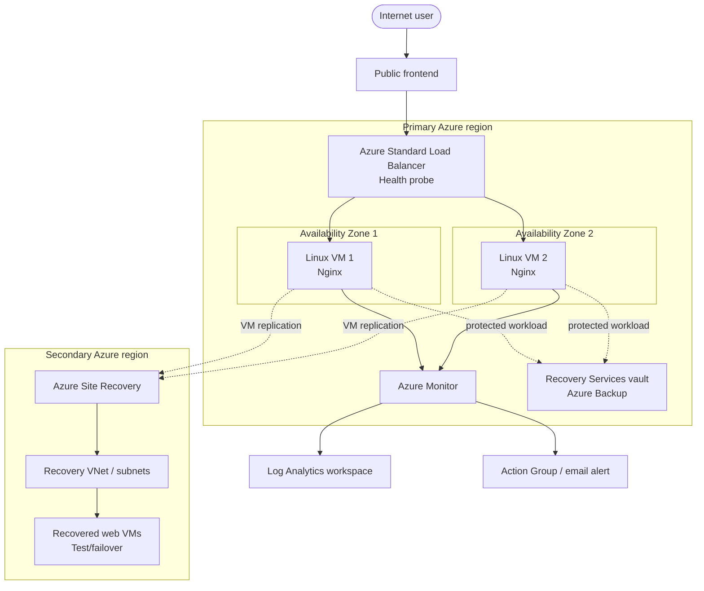

<div align="center">

# Azure Backup, High Availability & Disaster Recovery Lab

**An industry-style Azure infrastructure portfolio project**

[](https://azure.microsoft.com/)
[](https://www.terraform.io/)
[](https://ubuntu.com/)
[](docs/implementation-plan.md)

*Build it. Break it safely. Recover it. Prove it.*

</div>

---

## Project overview

This lab demonstrates how to design and validate resilience for a small web workload on Azure. It combines **high availability (HA)** inside a primary region, **backup and restore**, cross-region **disaster recovery (DR)** planning, monitoring, and infrastructure-as-code practices.

> **Important:** This repository is a guided lab blueprint with a Terraform foundation. It is not a claim that the full environment has already been deployed or tested. Complete the runbooks and record your own evidence before describing results on a resume.

## Architecture

### Logical architecture



### Recovery flow

```mermaid
flowchart LR
    A[Define RPO / RTO] --> B[Configure backup policy]
    B --> C[Run initial backup]
    C --> D[Restore test file or VM]
    D --> E[Enable Site Recovery replication]
    E --> F[Run test failover in isolated network]
    F --> G[Validate app and connectivity]
    G --> H[Document evidence and lessons learned]
    H --> I[Plan controlled failback]
```



See [docs/architecture.md](docs/architecture.md) for assumptions, traffic flow, and service boundaries.

## Goals and learning outcomes

- Deploy a redundant Nginx web tier behind a load balancer.
- Use health probes to route traffic only to healthy backend instances.
- Configure Azure VM backup, retention, and a restore test.
- Plan and validate Azure Site Recovery to a supported secondary region.
- Configure actionable monitoring and notifications.
- Use Terraform for repeatable infrastructure deployment.
- Document RPO/RTO, recovery procedures, test evidence, and cost cleanup.

## Services used

| Service | Purpose |
|---|---|
| Azure Virtual Machines | Two Linux web servers |
| Virtual Network, subnets, NSGs | Network segmentation and access control |
| Availability Zones | Resilience to a zonal failure where supported |
| Standard Load Balancer | Distributes traffic to healthy backend VMs |
| Recovery Services vault + Azure Backup | Backup retention and restore |
| Azure Site Recovery | Cross-region VM replication and recovery |
| Azure Monitor + Log Analytics | Metrics, logs, and operational visibility |
| Action Groups | Alert notifications |
| Azure RBAC | Least-privilege access |
| Terraform + Git | Repeatable provisioning and version control |

**Backup is not DR:** Backup restores data or a VM to a recovery point. Site Recovery is designed to orchestrate recovery of a running workload after a major disruption. HA, backup, and DR address different failure scenarios.

## Repository structure

```text
.
├── README.md
├── LICENSE
├── .gitignore
├── docs/
│   ├── architecture.md
│   ├── implementation-plan.md
│   ├── test-plan.md
│   ├── runbooks/
│   │   ├── backup-restore.md
│   │   ├── ha-failure-test.md
│   │   └── dr-test-failover.md
│   └── evidence/
│       └── README.md
├── terraform/
│   ├── README.md
│   ├── versions.tf
│   ├── variables.tf
│   ├── main.tf
│   ├── outputs.tf
│   └── cloud-init.yaml
└── scripts/
    ├── health-check.sh
    └── nginx-install.sh
```

## Getting started

### Prerequisites

- An Azure subscription with permission to create resources.
- Azure CLI, Terraform, Git, and an SSH client.
- A supported Azure region pair and VM size/quota availability.
- Cost awareness: backup storage, Site Recovery, compute, public IPs, load balancing, and monitoring can incur charges.

### 1. Sign in and choose a subscription

```bash
az login
az account list --output table
az account set --subscription "<SUBSCRIPTION_ID>"
az account show --output table
```

### 2. Review the implementation plan

Follow [docs/implementation-plan.md](docs/implementation-plan.md) in order. Start with the networking and web tier, then add backup, monitoring, and DR.

### 3. Review the Terraform starter

```bash
cd terraform
terraform init
terraform fmt -check
terraform validate
```

The Terraform foundation provisions a resource group, VNet/subnet, NSG, two Linux VMs, and a Standard Load Balancer. **Review and customize the code before applying it.** The sample uses passwordless SSH key authentication; supply your own public key. Full Azure Backup and Site Recovery configuration is documented as a separate implementation phase because vault, replication, regional support, and workload requirements must be verified for your subscription and chosen regions.

### 4. Deploy only after reviewing cost and security

```bash
terraform plan -out=tfplan
terraform apply tfplan
```

Never commit `terraform.tfstate`, private keys, credentials, or secrets. Destroy lab resources when finished:

```bash
terraform destroy
```

`terraform destroy` removes Terraform-managed infrastructure; separately verify any vault-protected items, recovery resources, and retained data before assuming all charges have stopped.

## Validation checklist

- [ ] Load balancer frontend responds over HTTP.
- [ ] Both backend VMs show healthy in the probe.
- [ ] Stop one backend VM and verify the app remains reachable through the other.
- [ ] Backup job completes successfully.
- [ ] Restore a test file or VM and verify its contents/service.
- [ ] Site Recovery replication health is healthy.
- [ ] Test failover completes in an isolated test network.
- [ ] Recovered application and network dependencies are validated.
- [ ] Alerts are triggered and delivered to the configured Action Group.
- [ ] RPO/RTO measurements and evidence are recorded.
- [ ] Lab resources are cleaned up.

## Portfolio evidence

Add your own screenshots and test results under `docs/evidence/`. Do not include subscription IDs, public IPs, email addresses, keys, or other sensitive information in public screenshots.

Suggested evidence:
1. Architecture diagram and deployed resource overview.
2. Load Balancer backend health.
3. Successful Azure Backup job and restore validation.
4. Site Recovery replication health and test failover results.
5. Azure Monitor alert and notification evidence.
6. A short incident timeline with observed recovery time.

## Resume bullet guidance

Only use metrics after you have measured them in your own lab. Example template:

> Built a resilient Azure web tier using Linux VMs, availability zones, and Azure Standard Load Balancer; validated backend health-based traffic routing and documented failure-recovery procedures.

> Configured Azure VM backup and tested recovery; designed cross-region Azure Site Recovery workflows and recorded observed recovery time against defined RPO/RTO targets.

## Official documentation

- [Azure VM backup quickstart](https://learn.microsoft.com/azure/backup/quick-backup-vm-portal)
- [Azure VM availability options](https://learn.microsoft.com/azure/virtual-machines/availability)
- [Azure Site Recovery architecture](https://learn.microsoft.com/azure/site-recovery/azure-to-azure-architecture)
- [Standard Load Balancer tutorial](https://learn.microsoft.com/azure/load-balancer/tutorial-load-balancer-standard-public-zonal-portal)
- [Terraform AzureRM provider](https://registry.terraform.io/providers/hashicorp/azurerm/latest/docs)
- [Azure Monitor overview](https://learn.microsoft.com/azure/azure-monitor/overview)

---

<div align="center">

**Learning project • Azure Infrastructure • Resilience Engineering**

</div>
