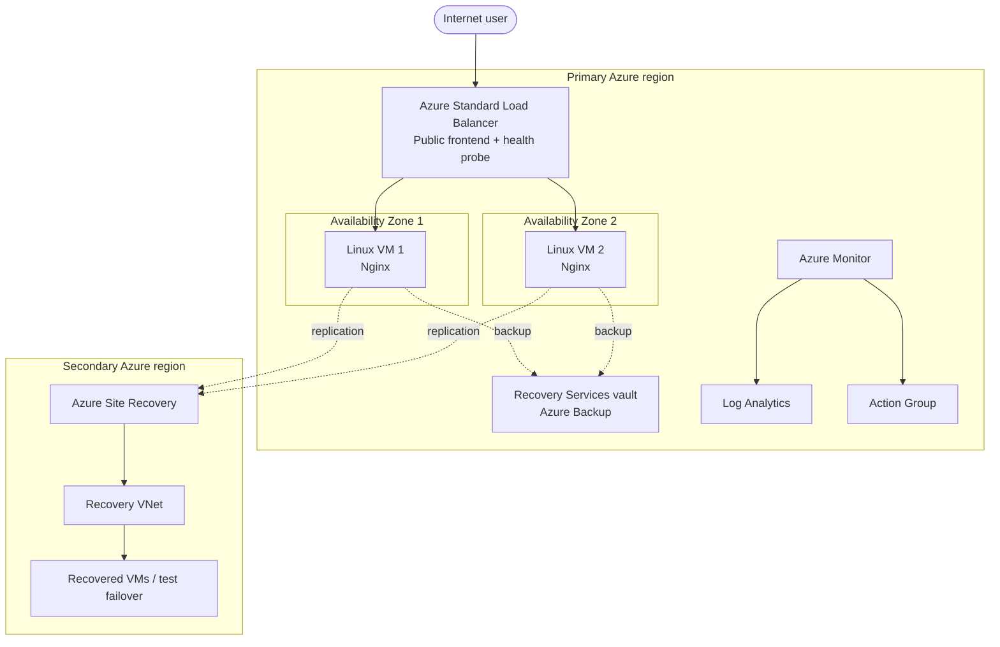

# Architecture and Design

## Scope
A lab-sized Nginx web workload with high availability in a primary Azure region, VM backup/restore, and a cross-region disaster recovery path.

## Logical architecture

## Request flow
1. Users reach the load balancer public frontend.
2. The health probe checks backend availability.
3. Traffic is distributed across healthy backend VMs.
4. If one backend becomes unhealthy, the other can continue serving requests, assuming remaining dependencies are healthy.

## Recovery boundaries
- **VM/process failure:** health probe and surviving backend provide local continuity.
- **Deleted/corrupted data:** recover from Azure Backup recovery point.
- **Regional disruption:** Azure Site Recovery can orchestrate recovery of supported replicated VMs in a secondary region.
- **Application/configuration issue:** redeploy or roll back configuration from source control where appropriate.

## RPO and RTO
- **RPO:** maximum acceptable data loss measured in time.
- **RTO:** target time to restore service.
Define targets before the exercise and record measured results. Any values in planning docs are lab targets, not Azure guarantees.

## Security and assumptions
- Do not expose SSH to the whole internet in production; use Bastion, VPN, jump host, or source-IP restrictions.
- The starter exposes HTTP only for a simple lab; add TLS and appropriate controls for real workloads.
- Use least-privilege RBAC and never commit secrets, private keys, or Terraform state.
- Verify regional pairs, VM/SKU support, quotas, zone support, and Site Recovery compatibility before deployment.
